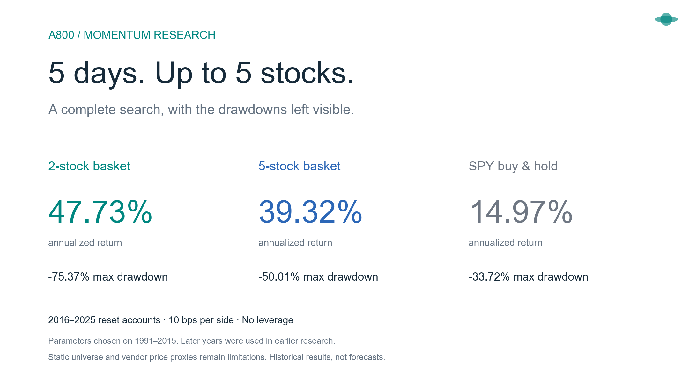
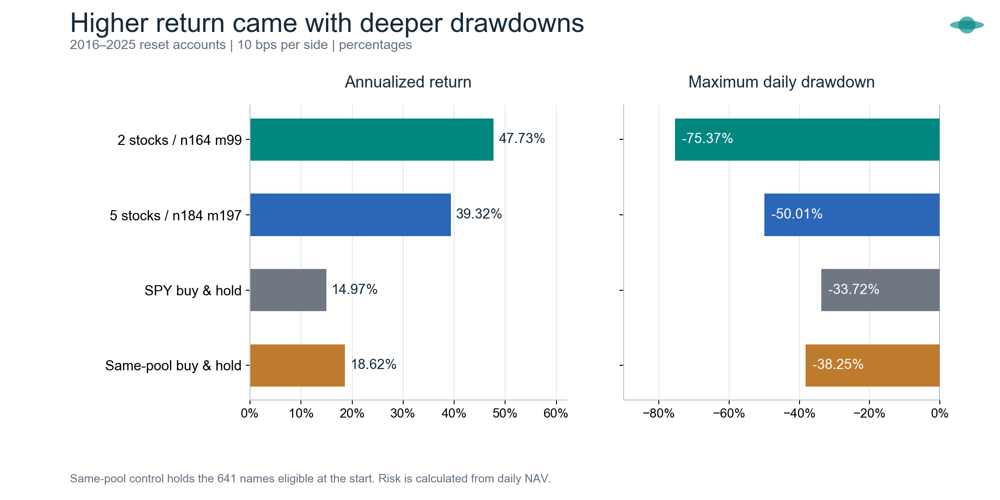
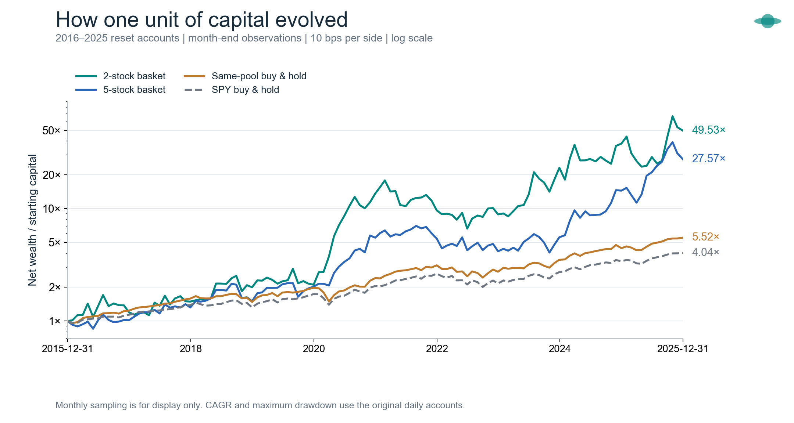
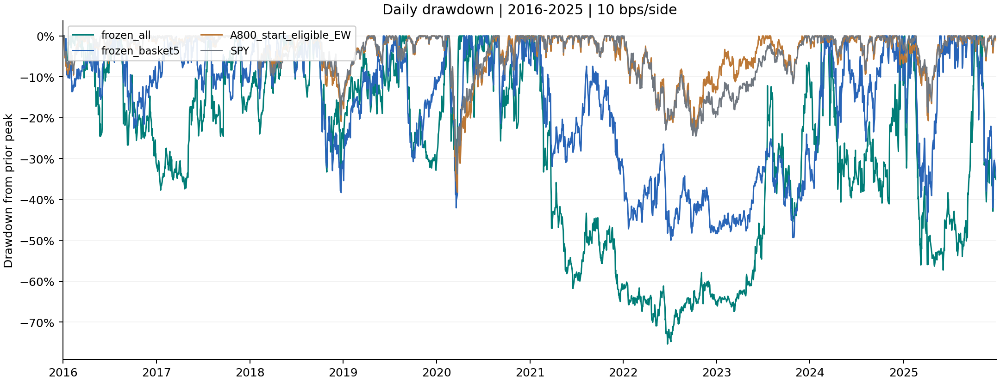
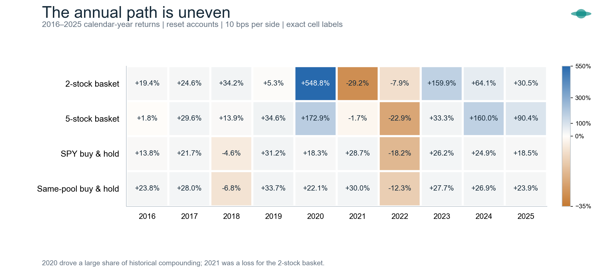
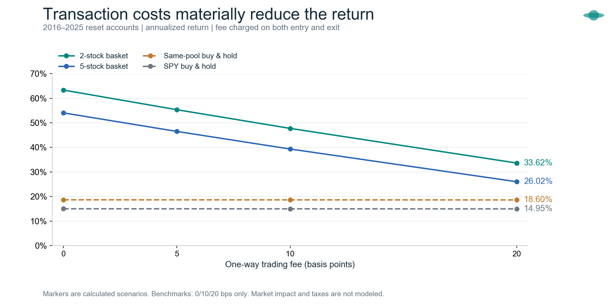
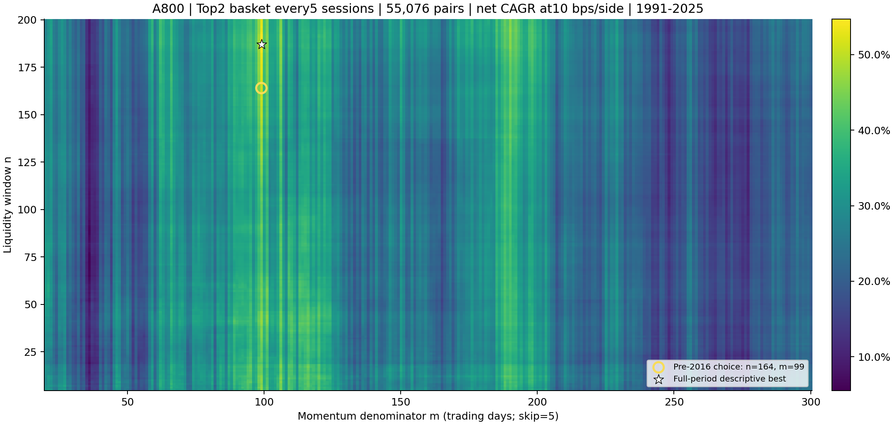
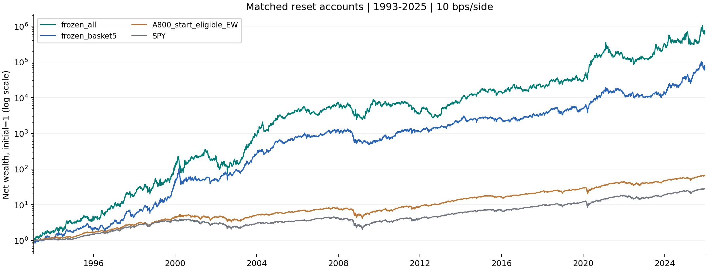

# A800 动量实验：持有5日，最多5只，能否跑赢买入持有？



在800只美股中穷举 **330,456种策略实例**，公开记录计算公式、全部参数结果、逐笔成交和独立复算证据。参数按1991—2015年开发期选择，下方重点看2016—2025年现金重置账户。

**历史回测跑赢了，承受的回撤也很深。** 单边费用0.1%，不加杠杆；2只候选净年化47.73%，最大回撤75.37%；5只候选净年化39.32%，最大回撤50.01%。这些是冻结历史数据上的结果，不能作为未来收益预期。

[浏览全部图片](research/report-assets/README.md) · [阅读公式与规则](research/docs/03-formulas.md) · [查看完整结果](research/docs/05-results.md) · [动手复现](research/docs/07-reproduction.md)

## 先看收益，也看付出的代价



|2016—2025年重置账户|净年化|最大回撤|
|---|---:|---:|
|2只候选：n164 / m99|47.73%|−75.37%|
|5只候选：n184 / m197|39.32%|−50.01%|
|SPY买入持有|14.97%|−33.72%|
|同池起点641只等权持有|18.62%|−38.25%|

所有行均扣单边10基点。2只候选的后段夏普约0.95，同池等权约0.97；更高年化没有带来全面的风险优势。完整结果还保留了每日轮换候选8.22%的后段年化，以及单只家族后段为负的失败方案。

## 资金是怎样走到终点的？



这张图把起始资金统一为1，使用**对数纵轴**，便于同时观察不同量级。曲线抽样到月末用于展示；年化与回撤仍按原始逐日账户计算。2只和5只账户每5个交易日整批换仓，目标单笔持有5个开盘到开盘的交易间隔。

## 最难熬的亏损阶段必须摆出来



2只候选从2021-02-09高点到2022-06-23低点回撤75.37%，直到2024-02-15才恢复该高点。这是策略路径的一部分。

原始图例中，`frozen_all`为2只候选，`frozen_basket5`为5只候选，`A800_start_eligible_EW`为起点合格股票等权买入持有。

## 好年份与坏年份放在同一张图里



2020年2只候选上涨548.79%，2021年下跌29.23%；同期SPY在2021年上涨28.73%。年度表说明收益集中在少数强年，也说明策略并非每年都赢。格子显示的是**年度收益**，不是年化收益率；原数值见 [annual_later_reset.csv](research/results/annual_later_reset.csv)。

## 把费用加倍，结果还剩多少？



2只候选后段年化从零费用63.33%降至10基点47.73%，20基点时为33.62%；5只对应54.04%、39.32%、26.02%。20基点下仍高于同费用的买入持有，但固定费率没有涵盖市场冲击、资金容量和税费。图中每个标记都是已计算的情景，基准只算了0/10/20基点。

## 参数地图：把全部55,076组摆出来



横轴是动量分母间隔m，纵轴是流动性窗口n。圆圈是仅按开发期选出的n164/m99；星号是看完全历史后最高的n187/m99，**不能作为提前选中的证据**。这张热力图展示1991—2025全期，仅作描述；其余五个家族也有完整CSV结果。

## 长期视角：与SPY从同一天重新开始



SPY从1993年才有数据，因此这组比较从1993-01-29现金重置，没有补造1991—1992年的SPY。它与上面的2016年起点属于不同账户。1991—2015既用于开发选参，也包含在这张长期图中，不能把整条曲线当成独立样本外验证。

## 怎样使用这个仓库

- **想先了解结果：** 从上面的图表开始，进一步阅读 [完整结果与失败方案](research/docs/05-results.md)。
- **想检查规则：** 查看 [全部公式](research/docs/03-formulas.md)、[交易规则](research/docs/04-trading-rules.md) 和 [验证限制](research/docs/06-validation.md)。
- **想亲自核查：** 克隆后运行恢复工具，取得全部660,912行费用结果和离线交互报告；[复现说明](research/docs/07-reproduction.md)列出原始输入要求。

```sh
git clone https://github.com/wongzijie/stock_database.git
cd stock_database
python3 research/scripts/restore_archives.py
```

**阅读边界：** 数据截止2025-12-31。800股名单事后已知，存在幸存者偏差；后段年份此前被研究过；供应商Close×Volume是成交金额代理，未重建历史原始名义金额。当前结论适用于这份冻结数据与执行近似，尚需点时、含退市证券的数据和未来跟踪验证。

## 从这里阅读

|内容|文档|
|---|---|
|研究范围、规则演变、数据截止与问题定义|[01 研究范围](research/docs/01-scope.md)|
|理论依据、文献来源，以及文献不能证明什么|[02 理论与参考资料](research/docs/02-theory.md)|
|数据资格、流动性、动量、账户、收益与风险公式|[03 全部计算公式](research/docs/03-formulas.md)|
|六种策略、买入卖出、换仓锚点与异常处理|[04 买卖与账户规则](research/docs/04-trading-rules.md)|
|开发期选参、完整结果、失败方案、费用和相位敏感性|[05 回测结果](research/docs/05-results.md)|
|测试、独立复算、偏差和尚未验证的内容|[06 验证与限制](research/docs/06-validation.md)|
|环境、输入要求、运行顺序、完整数据文件恢复|[07 复现说明](research/docs/07-reproduction.md)|
|结果文件字段与单位|[08 数据字典](research/docs/08-data-dictionary.md)|
|原研究完整中文报告与图表|[完整回测报告](research/reports/完整回测报告.md)|
|冻结研究协议与开发期选择记录|[PROTOCOL.json](research/PROTOCOL.json)、[冻结选择](research/results/development_frozen_choice.json)|
|原始研究程序|[code/](research/code/)|
|800个代码与原始CSV指纹|[universe_800.txt](research/data/universe_800.txt)、[source_manifest.json](research/data/source_manifest.json)|

## 覆盖范围

- n从5到200、m从20到300，均穷举全部整数：55,076组参数。
- 6种持仓方式：每5日整批持有1、2、3、4、5只，以及每天轮换1个初始20%资金批次。
- 共330,456种策略实例；各算0和10基点单边费用，合计660,912行结果。
- 原800股行情约507万行；共同信号起点1991-03-11，最后完整到期信号2025-12-22，账户终点2025-12-31开盘。
- 数值排序使用Olliee Ubuntu的RTX 5090；逐日现金与持仓账本使用编译后的CPU程序。

大结果文件以分块归档保存，避免单文件过大。克隆后执行 `python3 research/scripts/restore_archives.py`，可恢复完整660,912行结果、330,456行精简结果和自包含交互报告。分块清单和SHA256在 [archives/manifest.json](research/archives/manifest.json)。

原始行情CSV及大型中间矩阵没有随仓库分发；仓库中的输入清单、指纹、公式和程序明确说明了完全重算所需的输入。查看或核查已发表结果不需要原始行情。
