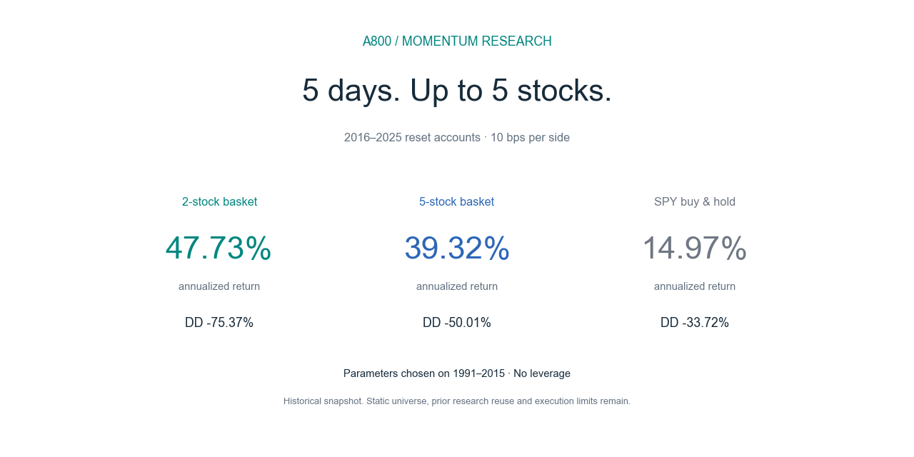

# A800 研究图表库

所有图片都可在GitHub直接查看，点击图片可进入原尺寸文件。数据实际截止2025-12-31；除费用敏感性另列情景外，图中统一扣单边10基点。图表源于冻结CSV/NPZ结果，没有重新选参。

新图片由 [render_github_visuals.py](../scripts/render_github_visuals.py) 生成，数值来源和展示口径见 [visualization-manifest.json](visualization-manifest.json)。原三张图保持原文件。仓库 [首页](../../README.md) 按阅读顺序提供解释。

|图片|时期|怎么看|
|---|---|---|
|[社交分享封面](social-preview.png)|2016—2025|1280×640，供链接分享使用|
|[研究封面](research-cover.png)|2016—2025|收益与最大回撤同屏展示，适合分享研究快照|
|[收益与风险](return-and-risk.png)|2016—2025|净CAGR与逐日最大回撤，相同费用与重置账户|
|[后段净值](later-wealth.png)|2016—2025|月末抽样，对数纵轴，基点2015-12-31现金1|
|[逐日回撤](drawdown.png)|2016—2025|原始图；frozen_all=2只，frozen_basket5=5只|
|[年度收益](annual-returns.png)|2016—2025|逐格年度回报，正负号与数值同时呈现|
|[费用敏感性](cost-sensitivity.png)|2016—2025|策略0/5/10/20bps；基准0/10/20bps|
|[全部参数地图](full-grid.png)|1991—2025|basket2全55,076组；圆圈开发期选择，星号事后最高|
|[长期同期净值](wealth.png)|1993—2025|从1993-01-29现金重置，对数纵轴；含开发期|

## 社交分享封面

专门用于仓库链接的社交预览，1280×640像素，重要文字和数字置于中央安全区域。

## 研究封面

收益与最大回撤同屏展示，适合分享研究快照。

## 收益与风险

净CAGR与逐日最大回撤，相同费用与重置账户。

## 后段净值

月末抽样，对数纵轴，基点2015-12-31现金1。

## 逐日回撤

原始图；frozen_all=2只，frozen_basket5=5只。

## 年度收益

逐格年度回报，正负号与数值同时呈现。

## 费用敏感性

策略0/5/10/20bps；基准0/10/20bps。

## 全部参数地图

basket2全55,076组；圆圈开发期选择，星号事后最高。

## 长期同期净值

从1993-01-29现金重置，对数纵轴；含开发期。

所有结论均为历史回测，静态股票池、历史复用、供应商价格代理与实盘执行限制见 [验证说明](../docs/06-validation.md)。
